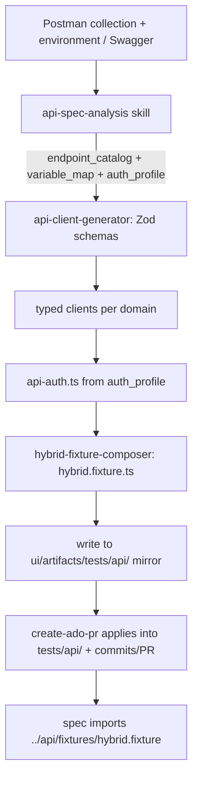
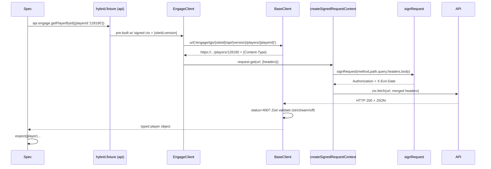

# API Test Layer

A typed, Playwright-based API layer that runs **alongside** the Page Object Model. It is
generated by the `build-api-layer` agent from an API source (Postman collection/environment,
OpenAPI/Swagger, a manual endpoint list, or one or more raw **curl** commands pasted inline or
read from a file such as `input.txt`) and is **domain-agnostic** — every domain,
path, request/response shape, header, and auth scheme is derived from the supplied source.

Specs consume it through a single hybrid fixture so a test can:

- **arrange** state via API (fast, deterministic)
- **act** through the UI (real user journey)
- **assert** backend side-effects via API
- **tear down** via API

---

## Where the API layer lives

```
tests/api/
  clients/     one <domain>.client.ts per domain (engage, player, rewards, ...) + _base.client.ts
  schemas/     one <domain>.schema.ts (Zod) per domain + _common.ts
  fixtures/    hybrid.fixture.ts — exposes { api, pages }
  auth/        api-auth.ts — request-signing wrapper (EVRI HMAC-SHA256 here)
```

Related config: `tests/config/test-config.api.ts`.

A review/upload mirror is also written to `.github/ui/artifacts/tests/api/` on each run;
the PR step copies the final files into `tests/api/`.

---

## Generation flow (source → files)



1. **Preflight** — `preflight-guardrails.ps1` installs `zod`/`typescript`/`@types/node` when `api_layer.enabled` is true.
2. **Analyze source** — `api-spec-analysis` parses the source into a normalized `endpoint_catalog`
   (grouped by Postman folders / OpenAPI tags / curl URL path segments), a `variable_map` (Postman env → literal/env-var),
   and an `auth_profile` (detected scheme, header/param names, required env vars). For `curl`, each
   command is tokenized into method / URL / headers / body, and secret-looking headers are redacted to env-var names.
3. **Schemas** — one `schemas/<domain>.schema.ts` (Zod) per domain.
4. **Clients** — one `clients/<domain>.client.ts` per domain; each method calls Playwright
   `APIRequestContext` and validates the response with its schema.
5. **Auth** — `auth/api-auth.ts` reproducing the source's scheme.
6. **Fixture** — `fixtures/hybrid.fixture.ts` registering every client under `api` and every page under `pages`.
7. **Ship** — files land in the artifact mirror, then the PR step applies them under `tests/api/`.

---

## Wiring the API layer into a spec

Specs import `test` + `expect` from the fixture (never the clients directly):

```ts
// tests/specs/player-balance.spec.ts
import { test, expect } from '../api/fixtures/hybrid.fixture';

test.describe('Engage · player balance', () => {
  test('returns a balance for the player', async ({ api }) => {
    const balance = await api.engage.getPlayerBalance();   // signed + validated
    expect(balance).toBeDefined();
  });
});
```

For hybrid (API + UI) specs you also get `pages` from the same fixture:

```ts
test('login via UI, verify via API', async ({ api, pages }) => {
  // ARRANGE (api)
  // ACT (ui)
  await pages.login.goto();
  // ASSERT (api)
});
```

---

## Inputs to pass

### Environment variables (read once by the fixture/config)

| Env var | Purpose | Needed for |
| --- | --- | --- |
| `API_BASE_URL` | host base URL | **always** (fixture throws without it) |
| `TRILOGY_DOMAIN_BASE_URL` | second base URL | `controlPanel`, `kioskManager` (falls back to `API_BASE_URL`) |
| `API_SCHEMA_VALIDATION` | `strict` \| `warn` \| `off` | response-validation strictness (default `warn`) |
| `API_SITE_ID` | `{siteId}` default | `engage`, `enroll`, `content`, `epg`, `jx` |
| `API_VERSION` | `{version}` default (`v1`) | same group |
| `API_EPG_PATH` / `API_JX_TENANT_ID` / `API_JX_PROPERTY_ID` | path defaults | `epg` / `jx` |
| `API_KEY`, `API_SECRET_KEY`, `API_TENANT_ID`, `API_SERVICE_NAME` | EVRI HMAC signing credentials | any authenticated call |

These live in `.env` (loaded by `playwright.config.ts`) and are surfaced via `tests/config/test-config.api.ts`.

### Per-call inputs (arguments to the client method)

- **Path params** — e.g. `api.engage.logout({ playerId: '128190' })`.
- **Site/version overrides** — engage methods accept `{ siteId?, version? }` to override env defaults per call.
- **Request bodies** — typed and Zod-validated on the way out:

```ts
await api.engage.updatePlayerPhone(
  { phone: [{ phoneNumber: '+15551234567', primaryPhone: true }] },
  { siteId: '1', version: 'v1' },
);
```

---

## Asserting the response

Three complementary layers:

**1. Status (implicit).** `BaseClient.parse()` throws on HTTP ≥ 400, so a successful `await` means 2xx.

```ts
await expect(api.engage.getPlayerBalance()).resolves.toBeDefined();
await expect(api.engage.logout({ playerId: 'bad' })).rejects.toThrow(/HTTP 4\d\d/);
```

**2. Schema (automatic).** Each method validates the response with its Zod schema. Set
`API_SCHEMA_VALIDATION=strict` to make a shape mismatch fail the test; `warn` only logs.

**3. Field-level.** Assert on the returned typed object:

```ts
const balance = await api.engage.getPlayerBalance();
expect(balance).toMatchObject({ currency: expect.any(String) });
expect(balance.balance).toBeGreaterThanOrEqual(0);
```

> **Caveat:** when the source collection has no saved example responses, generated response
> schemas fall back to `z.unknown()` (see `engage.schema.ts`). In that state, `strict` has
> nothing to validate and field access won't type-check. Tighten the schema to enable real
> assertions:
>
> ```ts
> export const GetPlayerBalanceResponseSchema = z.object({
>   balance:  z.number(),
>   currency: z.string(),
> });
> ```

---

## Anatomy of a request (worked example)

Using this request:

```
GET https://trilogy-go-qa01.purplecheckpoint.com/engage/tgo/1/api/v1/players/128190
X-Evri-TerminalId: Mobile_1
X-Evri-TenantId:   20260127145540557
x-evri-device-type: Mobile
```

### URL decomposition

| Curl segment | Framework meaning | Resolved by |
| --- | --- | --- |
| `trilogy-go-qa01.purplecheckpoint.com` | `API_BASE_URL` | fixture `requireEnv('API_BASE_URL')` |
| `/engage` | service → `EngageClient` + HMAC `serviceName` | `inferServiceFromPath()` |
| `tgo/1` | `siteId = 1` | `API_SITE_ID` → `EngagePathDefaults` |
| `api/v1` | `version = v1` | `API_VERSION` |
| `players/128190` | resource + `playerId` path param | client method template |

### 1) Fixture (`hybrid.fixture.ts`)

`extend`s Playwright's base `test` with four fixtures:

```ts
export const test = base.extend<HybridFixtures>({
  apiRequest: async ({}, use) => {
    const baseURL = requireEnv('API_BASE_URL');
    const raw    = await playwrightRequest.newContext({ baseURL });
    const signed = createSignedRequestContext(raw, { baseUrl: baseURL });  // auto-signing
    await use(signed);
    await raw.dispose();
  },
  trilogyDomainRequest: async ({}, use) => { /* second base URL, same signing */ },
  api: async ({ apiRequest, trilogyDomainRequest }, use) => {
    const hostOpts = { request: apiRequest, baseUrl: apiBaseUrl, schemaValidation };
    const clients = {
      engage: new EngageClient(hostOpts, { siteId, version }),
      player: new PlayerClient(hostOpts),
      controlPanel: new ControlPanelClient(trilogyOpts),  // different base
      // ...one per domain
    };
    await use(clients);
  },
  pages: async ({ page }, use) => { /* one instance per Page Object */ },
});
export { expect };
```

- **`apiRequest` vs `trilogyDomainRequest`** — two signed contexts for two base URLs.
- **`api`** — hands each client a signed `APIRequestContext` plus path defaults (`siteId`, `version`).
- **`pages`** — Page Objects in the same fixture, enabling hybrid specs.
- **`patchStepScreenshots(test)`** — screenshots every `test.step(...)`.

### 2) Client method (`engage.client.ts`)

```ts
async getPlayerById(args: { playerId: string; siteId?: string; version?: string }) {
  const params = { ...this.p(args), playerId: args.playerId };  // fills siteId/version defaults
  const res = await this.opts.request.get(
    this.url('/engage/tgo/{siteId}/api/{version}/players/{playerId}', params),
    { headers: this.headers() });
  return this.parse(res, GetPlayerByIdResponseSchema, 'engage.getPlayerById');
}
```

### 3) BaseClient — URL + headers (`_base.client.ts`)

```ts
protected url(path, pathParams) {
  let resolved = path;
  for (const [k, v] of Object.entries(pathParams))
    resolved = resolved.replace(`{${k}}`, encodeURIComponent(String(v)));
  const remaining = resolved.match(/\{([^}]+)\}/);
  if (remaining) throw new Error(`[api] missing path param "${remaining[1]}"`);
  return `${this.opts.baseUrl}${resolved}`;
}

protected headers(extra) {
  // Authorization + X-Evri-Date are injected by the signed context.
  return { 'Content-Type': 'application/json', ...(extra ?? {}) };
}
```

> Custom headers (`X-Evri-TerminalId`, `X-Evri-TenantId`, `x-evri-device-type`) are **not**
> set by default `headers()`. Pass them via `this.headers({ ... })` so they get signed.

### 4) Signed context (`api-auth.ts`)

`apiRequest` is a `Proxy` — every `get/post/...` is intercepted and signed:

```ts
const handler = {
  get(target, prop) {
    if (VERB_METHODS.includes(prop))
      return (url, options) => signedFetch(prop.toUpperCase(), url, options);
    // fetch handled too; dispose/storageState pass through
  },
};
return new Proxy(ctx, handler);
```

`signedFetch` splits the URL, infers the service, signs, merges headers:

```ts
const { path, query } = splitUrl(url, opts.baseUrl, options?.params);
const service = process.env.API_SERVICE_NAME ?? inferServiceFromPath(path); // "engage"
const signed  = signRequest({ method, path, query, body, headers, credentials: { serviceName: service } });
return ctx.fetch(url, { ...options, method, headers: { ...incomingHeaders, ...signed.headers } });
```

**`signRequest` — EVRI HMAC-SHA256** (port of the Postman `SignaturePacketAuth` script):

```
1. canonicalRequest = [method, canonicalPath, canonicalQuery, canonicalHeaders, signedHeaders, sha256(payload)].join("\n")
2. credentialScope  = `${date}/${tenantId}/${serviceName}/evri1_request`
   stringToSign     = ["HmacSHA256", dateTime, credentialScope, sha256(canonicalRequest)].join("\n")
3. signingKey       = deriveSigningKey(secretKey, date, tenantId, serviceName)
   signature        = hmac(signingKey, stringToSign)
4. Authorization: HmacSHA256 Credential=<apiKey>/<scope>, SignedHeaders=content-type;x-evri-date, Signature=<hex>
   X-Evri-Date:   20260819T...Z   (signed AND sent)
```

Credentials come from env via `resolveCredentials()` (`API_KEY`, `API_SECRET_KEY`,
`API_TENANT_ID`, `API_SERVICE_NAME`) — never inlined.

### 5) Response handling (`BaseClient.parse`)

```ts
protected async parse(response, schema, label) {
  const status = response.status();
  const body   = JSON.parse(await response.text() || 'null');
  if (status >= 400) throw new Error(`[api] ${label} -> HTTP ${status}`);  // status assertion
  const mode = this.opts.schemaValidation ?? 'warn';
  if (mode === 'off') return body;
  const result = schema.safeParse(body);                                    // schema assertion
  if (result.success) return result.data;
  if (mode === 'strict') throw new Error(`schema mismatch for ${label}`);
  console.warn(...); return body;
}
```

### End-to-end sequence



---

## Running API / hybrid specs

```bash
# All specs
npx playwright test

# A single hybrid spec
npx playwright test tests/specs/login-and-tenant-selection.hybrid.spec.ts

# Make response-schema mismatches fail
API_SCHEMA_VALIDATION=strict npx playwright test
```
